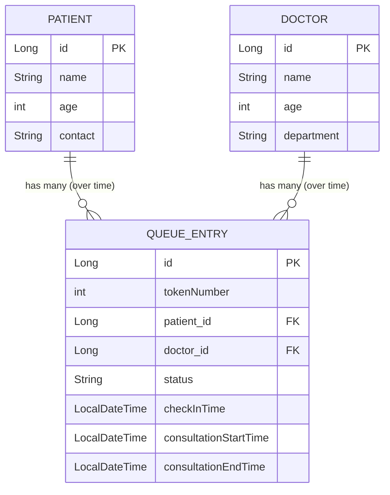
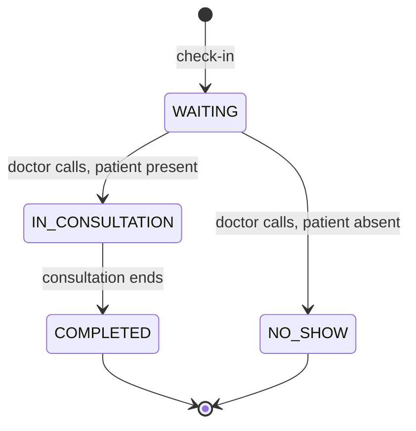

# Architecture & Design Documentation

This document tracks *why* things are built the way they are — intended both as a
reference while building, and as prep material for explaining design decisions in
interviews.

---

## 1. Layered Architecture: Controller → Service → Repository

**Roles:**
- **Controller** — HTTP only. Receives requests, returns responses. No business logic, no DB access.
- **Service** — business logic and rules live here. Only layer allowed to make decisions
  (e.g. "is this transition allowed", "does this patient exist").
- **Repository** — database access only (`JpaRepository`). No knowledge of *why* something
  is being saved/queried.

**Why this architecture, specifically:**
- Separation of concerns — DB changes don't ripple into Controllers; business rule changes
  don't touch HTTP or SQL code.
- Testability — Service logic can be tested by mocking the Repository, no real DB or web
  server needed.
- Matches Spring's own idiom (`@Service`, `@Repository`, dependency injection assumes this shape).

**Why not alternatives:**
- *Transaction Script* (logic dumped in one method) — doesn't scale once features interact.
- *Hexagonal/Clean Architecture* — more separation than needed while still learning core
  Spring Boot; a "grow into it later" architecture.
- *Fat-model / Active Record* — blurs data shape with behavior; less idiomatic in Spring.
- *Microservices* — solves team/scale problems this project doesn't have (one developer,
  one deployable unit). Would add real operational overhead (separate deployments, databases,
  network calls between services) for no actual benefit at this scale.

**This is a REST API with layered architecture, not MVC** — there is no server-rendered
View; Spring Boot returns JSON, and Flutter renders the UI on a separate device.

---

## 2. Recurring Service ↔ Controller contract

Every Service method whose outcome the Controller must react to returns a signal —
never `void`:

- `Optional<T>` — for "find or fail" cases (get-by-id, update)
- `boolean` — for simple success/fail cases (delete)

Every Controller method converts that signal into the correct HTTP response:

```java
// When Service returns Optional<T>
return someOptional
        .map(ResponseEntity::ok)
        .orElse(ResponseEntity.notFound().build());

// When Service returns boolean
return result
        ? ResponseEntity.noContent().build()
        : ResponseEntity.notFound().build();
```

---

## 3. Entities and relationships (current + planned)



`QueueEntry` uses `@ManyToOne` to Patient and Doctor — many queue entries (across
different visits, over time) reference the same patient/doctor. A patient does not
have multiple *simultaneous* active entries, but does accumulate historical entries
across visits — this preserves visit history for analytics and per-visit notes later.

---

## 4. Queue state machine (State pattern)

**Design decision**: implemented as a Java `enum` with constant-specific method bodies,
rather than the textbook GoF version (separate class per state implementing a shared
interface). This is a documented, deliberate simplification — each enum constant still
overrides its own `canTransitionTo` logic, preserving the core idea of the State pattern
(each state owns its own valid-transition rules) with less boilerplate. The classic
class-per-state version is understood and can be described if asked, but wasn't judged
worth the extra files for a fixed, small set of states.



**Scoping note**: "absconded" (a patient admitted post-surgery/in a ward who leaves
without authorization) is a *different, higher-stakes* scenario than an OP patient
simply not being present when called. These were initially conflated and have been
deliberately separated:
- `NO_SHOW` — OP queue only, low-stakes, patient can be manually re-checked-in later.
- True "absconded" (admitted patient) — belongs to a future `Admission` entity/workflow,
  not part of this queue's state machine. Deferred, not built.

---

## 5. Current API surface

| Method | Endpoint | Purpose | Status |
|---|---|---|---|
| GET | `/api/patients` | List patients | Done |
| GET | `/api/patients/{id}` | Get one patient | Done |
| POST | `/api/patients` | Create patient | Done |
| PUT | `/api/patients/{id}` | Update patient | Done |
| DELETE | `/api/patients/{id}` | Delete patient | Done |
| GET | `/api/doctors` | List doctors | Done |
| GET | `/api/doctors/{id}` | Get one doctor | Done |
| POST | `/api/doctors` | Create doctor | Done |
| PUT | `/api/doctors/{id}` | Update doctor | Done |
| DELETE | `/api/doctors/{id}` | Delete doctor | Done |
| POST | `/api/queue/checkin` | Check in a patient to a doctor's queue | Done |
| POST | `/api/queue/{id}/call-next` | Advance WAITING → IN_CONSULTATION | Done |
| POST | `/api/queue/{id}/complete` | Advance IN_CONSULTATION → COMPLETED | Done |
| POST | `/api/queue/{id}/no-show` | Advance WAITING → NO_SHOW | Done |
| GET | `/api/queue/doctor/{doctorId}` | View a doctor's current active queue (today, WAITING/IN_CONSULTATION only) | Done |

**Centralized error handling**: `GlobalExceptionHandler` (`@ControllerAdvice`) now
handles `IllegalArgumentException` (→ 404, not found), `IllegalStateException` (→ 400,
illegal state transition), and `MethodArgumentNotValidException` (→ 400, validation
failure) across all Controllers — replacing per-method try-catch blocks.

**MVP status: functionally complete.** Full endpoint reference with request/response
examples: see `api_endpoint_reference.md`.

---

## 6. Decisions explicitly deferred (with reasoning)

| Decision | Reasoning |
|---|---|
| No WebSockets for queue updates | Polling every few seconds is imperceptible to a human waiting in a queue; avoids connection lifecycle complexity (reconnects, multiple open connections) for no felt benefit at this scale. |
| No Redis | Solves caching/read-scale problems this single-hospital project doesn't have. |
| No Kafka/RabbitMQ | Solves async communication between separate services; this is a monolith with no "other service" to notify. |
| No Docker/CI-CD yet | Scoped for later, once core features are functionally complete. |
| Spring Security deferred | Built core CRUD/business logic first, unsecured, to avoid learning Spring Boot and Spring Security simultaneously; security added once the app already works end-to-end. |
| Estimated wait-time (a projected number, not elapsed time) not implemented | Requires historical average-consultation-time data to be meaningful; adds complexity disproportionate to MVP value. Elapsed time (a live calculation from check-in timestamp) is implemented instead. |

---

## 7. Log of real bugs hit and fixed (useful for interview "tell me about a bug you fixed")

- **DataSource auto-configuration failure** — adding JPA + Postgres dependencies triggered
  Spring's auto-configuration to attempt building a `DataSource` bean before connection
  details existed in `application.properties`, failing the whole app at startup.
- **`JpaRepository<Patient, Long>` mismatch** — entity's `@Id` field was initially `int`,
  mismatched against the repository's declared `Long` key type.
- **Missing `.save()` in update logic** — an update method mutated the fetched entity's
  fields in memory but never persisted the change back via the repository.
- **`void` return type breaking a Controller** — a Service method returning `void` gave
  the Controller no signal to build a `ResponseEntity` from, since success/failure were
  indistinguishable from the return value alone.
