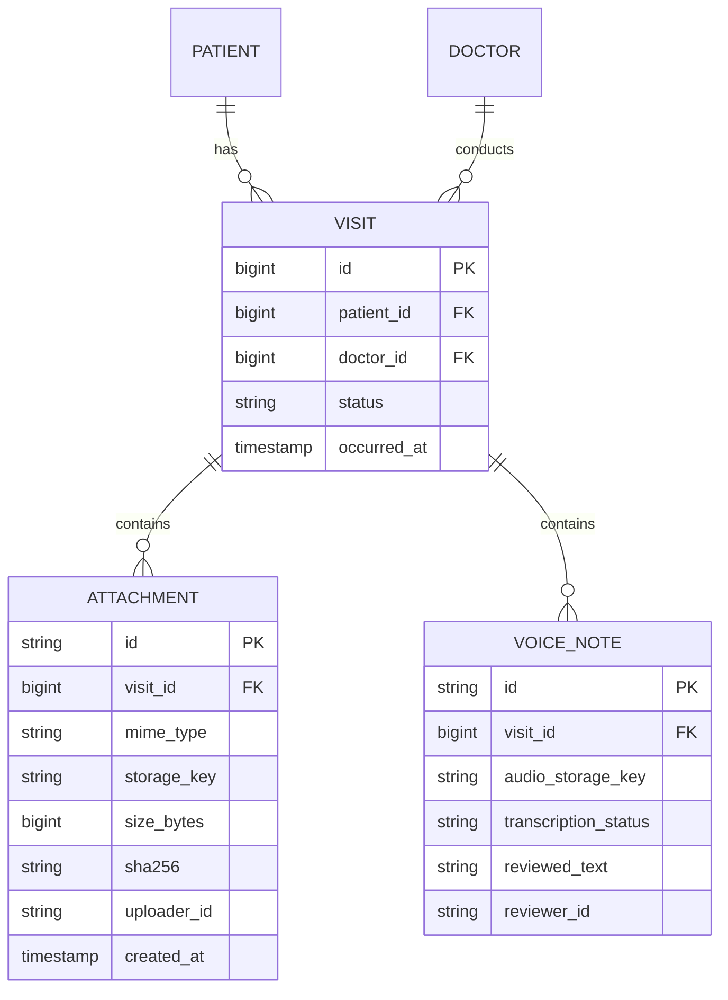

# Planned clinical documentation module — future design only

The original purpose includes doctor access to visit files, X-rays and optional voice notes. These **are not implemented** in the current code and UI labels them as planned.

## Proposed model

## Security and privacy requirements

- Verify clinician-to-patient care relationship at every read, upload and download; no broad role-only file access.
- Store binaries in private object storage or access-controlled local encrypted storage, not public static folders or database blobs by default.
- Whitelist formats, enforce content-type and file signatures, size limits, antivirus/malware scanning and safe file naming.
- Generate short-lived signed URLs only after authorization; log document access for audit. Avoid including identifiers or keys in general application logs.
- Obtain explicit consent and display recording status before audio capture; allow stop/discard; retain only minimum audio and transcript for approved purpose.
- AI transcription can make errors; requires human confirmation, provenance, limited retention and no automatic clinical diagnosis.
- Cover data deletion/retention, backup/encryption keys, cross-region processing and applicable privacy/compliance review.

## Proposed phases

1. Introduce visit identity separate from queue entry; backward-compatible migration and doctor-patient assignment model.
2. Add patient document metadata and access-controlled upload/download with synthetic files; test ownership and malicious files.
3. Add voice recording client behind consent and secure storage, *without* automatic medical summarization.
4. Add opt-in transcription, clinician review UI and evaluation against synthetic reference transcripts.
5. Only after security and legal review consider clinical integrations; real patient data is forbidden in this portfolio prototype.

## Interview design rationale

A queue record is a visit workflow event, not a complete EHR. Treating attachments and notes as separate permissioned visit resources allows independent retention, testing and audit. Delaying implementation until the security boundaries exist is a deliberate scope decision, not an undocumented gap.
