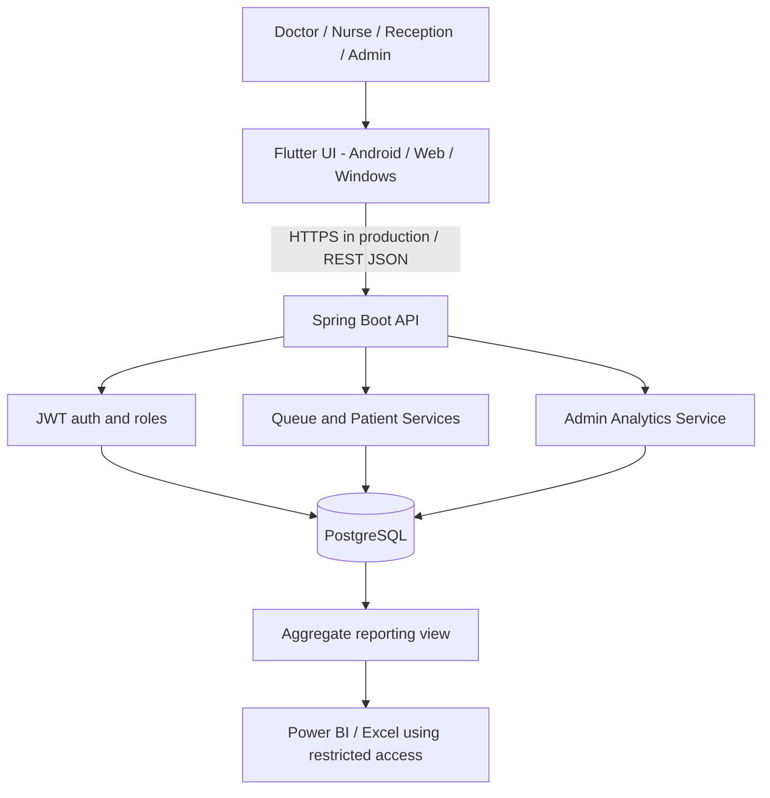
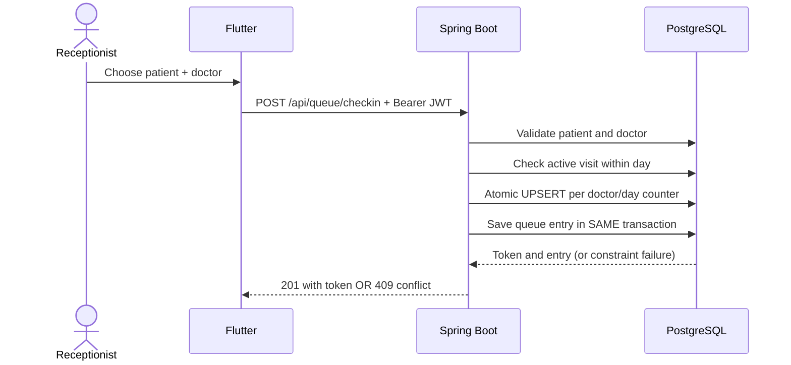

# High-level design — CareFlow OP v2

## Product goals

**Primary users:** doctor (queue/consultation/visit history), receptionist (patient registration/check-in), nurse (read patient/queue), admin (manage staff and doctors; aggregate operational reports). This is a doctor-first outpatient workflow tool, **not** a business intelligence product with a clinical wrapper.

**Business problem:** reduce fragmentation across outpatient check-in, doctor queues and patient visit history; provide admin insights without disclosing patient identifiers in reporting.

**Out of scope for current deliverable:** clinical attachments/X-rays, voice recording/transcription, referrals, cross-hospital integrations, AI diagnosis, production healthcare compliance and microservice decomposition.

## System context

## Components

- **Flutter**: Material 3 responsive interface, in-memory access token, `/api/users/me` role retrieval, screens for queue, patients, check-in, and admin insights. No direct database access.
- **Spring MVC controllers**: input validation and response mapping for auth, patients, doctors, queues, analytics.
- **Services**: business transitions, duplicate check-in rules, PostgreSQL token allocation, aggregated metrics.
- **JPA repositories**: entities and relational persistence; **JdbcTemplate** for the PostgreSQL `UPSERT ... RETURNING` allocation query; same transaction manager/DataSource.
- **PostgreSQL**: single source of truth; explicit migration/uniqueness constraints; BI aggregate view.

## Security boundaries

- Unauthenticated: login only.
- ADMIN: staff registration, doctor registry edits, aggregate analytics, all queue actions.
- RECEPTIONIST: patient registration/edit, check-in, queue observation.
- DOCTOR: queue observation and status changes, patient lookup/history.
- NURSE: queue/patient read, visit history.
- JWT is signed using an external, persistent secret; backend verifies user and current role in the database on each request.

**Limitations:** no binding between a DOCTOR staff account and its own Doctor profile; no departmental patient-access scoping. For real patient data this must be designed and enforced before deployment. The current role matrix alone is insufficient for clinical confidentiality. Browser CORS is localhost-only by default; Flutter native platform networking differs. TLS and secure persistent token storage must be added before any deployment.

## Data flow: check-in

## Deployment and scalability decisions

- Modular monolith is sufficient for this solo, single-clinic MVP; microservices would add operational overhead without evidence of need.
- PostgreSQL constraints protect against application-level races. This is different from Java `synchronized` blocks, which cannot coordinate multiple servers.
- No Kafka, Redis, Kubernetes or online patient-upload infrastructure is introduced only for resume keywords.
- Backend and Flutter reside in **separate source folders**; the backend `.git` history remains owned by the user.

## Failure modes

- Missing JWT secret → backend fails startup rather than using an insecure default.
- Incompatible database schema → Hibernate `validate` fails startup instead of silently half-applying DDL.
- Concurrent duplicate check-in → partial unique database index rejects; service attempts to surface HTTP 409.
- Network loss → Flutter shows a retryable error, not local fabricated success.
- Missing doctor/empty queue → explicit empty states.

See `LOW_LEVEL_DESIGN_V2.md` and `MIGRATION_DESIGN.md` for implementation details.
