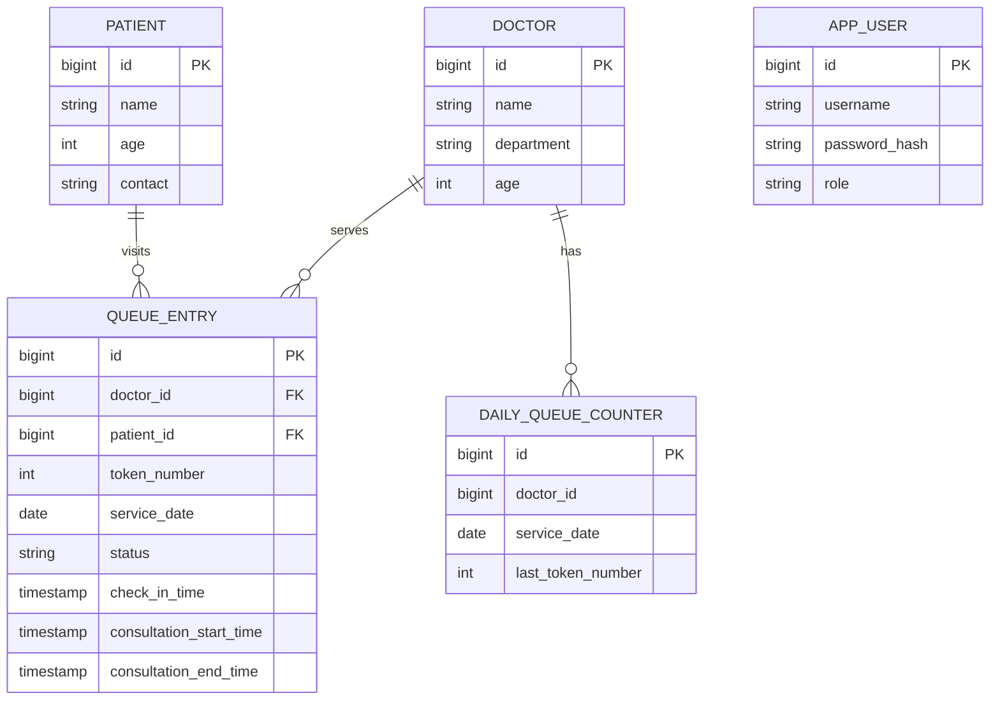
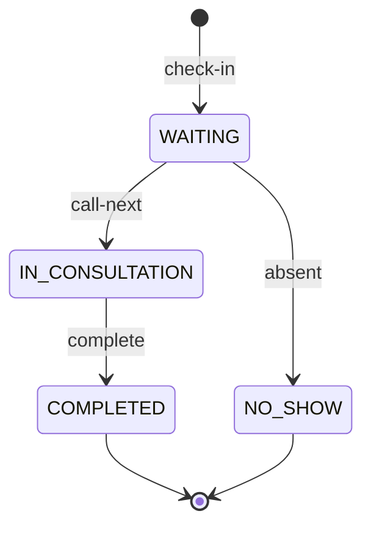

# Low-level design — CareFlow OP v2

## Core entities

`APP_USER` has **no doctor_profile foreign key** in this version; see backlog before attempting real clinical deployment.

## State machine

Only DOCTOR/ADMIN can change state. Only one consultation per doctor/day is enforced by a partial database unique index. The service also checks for an existing consultation and returns a human-readable conflict; database constraints remain the definitive concurrency guard.

## Token allocation (per doctor + service date)

1. Controller receives patient and doctor IDs and authenticates the receptionist/admin.
2. Service finds referenced entities and checks for existing active same-day check-in.
3. In a transaction, `PostgresQueueTokenAllocator` executes `INSERT INTO daily_queue_counter ... ON CONFLICT ... DO UPDATE ... RETURNING last_token_number` via `JdbcTemplate`.
4. Service saves and flushes the `QueueEntry` using Spring Data JPA in the same transaction.
5. Partial unique indexes guarantee no duplicate active patient/doctor/day, one active consultation/doctor/day; regular unique index guarantees token uniqueness/doctor/day.
6. On failure the entire transaction rolls back, including counter increment. Database triggers are not used.

**Test note:** the carried-forward multithreaded unit test uses an atomic in-memory stub and therefore **does not prove PostgreSQL transaction integration**. Add a Testcontainers or live test-DB concurrency test locally before claiming DB-level concurrency verified.

## Time handling

Timestamps are `LocalDateTime` and legacy dates are derived via `check_in_time::date` under a **clinic-local clock assumption**. Check-in service generates service date from one timestamp to avoid crossing midnight between values. Cross-timezone users, overnight visits, daylight-saving changes and multiple clinics require a future UTC + explicit `ZoneId` model.

## Security implementation

- `JwtUtil`: env-provided secret >=32 UTF-8 bytes, HS256 signed token with username and role; expiration default 10 hours.
- `JwtAuthFilter`: parses/verifies JWT, looks up current user and ensures role claim matches the database. Doesn't log tokens or JWT internals.
- `SecurityConfig`: stateless access, public login, ADMIN-only registration and analytics; matching method/path role rules.
- `AdminBootstrap`: only creates first ADMIN with explicitly provided env vars; no default seeded credentials. Secrets are not committed.
- `UserService`: BCrypt hashes staff passwords; duplicate account creation rejected.

**Non-goals / security debt:** password reset, refresh tokens, user revocation beyond DB-user deletion/role mismatch, rate limiting, multi-tenant scoping, audit trails, access logging without sensitive details, secure token persistence, CSRF for future cookie auth, production TLS.

## Analytics formulas

- `checkins`: count queue entries in date range.
- `completed`: status COMPLETED count.
- `no-show rate`: NO_SHOW count divided by checkins × 100 (0 if none).
- `wait minutes`: `EXTRACT(EPOCH FROM (consultation_start_time - check_in_time)) / 60` where start >= check-in.
- `avgWaitMinutes`: arithmetic mean over **started** consultations with valid timestamps.
- `p90WaitMinutes`: PostgreSQL `percentile_cont(0.9)` over same valid waits; NULL when none.
- Daily trend groups by service_date, with the same optional doctor filter; **ADMIN-only** until doctor mapping/scoping exists.

No wait-time predictor is claimed. Do not interpret no-show rate and completed fraction as causal performance measures without understanding case mix.

## Flutter client implementation

- `lib/main.dart` owns login state and responsive navigation shell.
- `lib/src/api.dart` handles REST/JSON/JWT error parsing and uses `--dart-define=API_BASE_URL=...`.
- `lib/src/ui.dart` defines app theme, cards, error/empty components.
- `lib/src/screens.dart` contains queue, patients, check-in, patient history, and admin insights screens.
- Tokens are deliberately **in memory** (log in each launch); secure persistent token storage is future work.
- Report/X-ray/voice UI is a clearly labeled planned module, with no fabricated functionality.

## Run and test decisions

SQL migration is explicit; `spring.jpa.hibernate.ddl-auto=validate` prevents Hibernate from attempting in-place schema modifications. Unit tests must be rerun locally after applying migration. Flutter sources must be scaffolded/analyzed with the user's installed Flutter toolchain; they were not executed inside this artifact environment.
