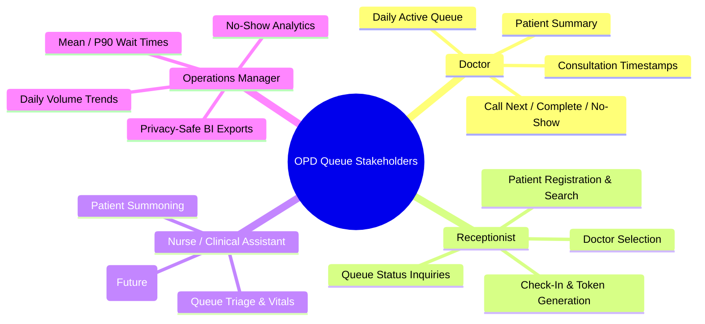

# Business Requirements Document (BRD) & Functional Requirements (FRD)

**Project Name**: Outpatient Patient Queue Management System 2.0
**Domain**: Healthcare Outpatient Services (OPD)
**Target Architecture**: Spring Boot REST Backend + Flutter Cross-Platform Client + PostgreSQL
**Document Milestone**: M0 Baseline Specification

---

## 1. Executive Summary & Business Problem

In typical outpatient healthcare facilities, manual or uncoordinated patient queue tracking results in severe operational friction:
1. **Unpredictable Waiting Times**: Patients experience anxiety and crowding in waiting rooms without visibility into queue position or token status.
2. **Doctor Workload Inefficiency**: Clinicians manually check waiting areas or rely on paper files, causing consultation delays and disjointed status tracking.
3. **Double Token Allocations & Conflicts**: Under rush hours, reception staff checking in patients concurrently can assign duplicate tokens or lose track of cancellations and no-shows.
4. **Data Blindness for Clinic Supervisors**: Clinic managers lack privacy-safe, aggregated insights into patient volume, peak wait durations, and no-show patterns.

The **Patient Queue Management System 2.0** provides a doctor-first, reliable digital queue platform. It enables receptionists to register and check in patients safely, gives doctors instant visibility and transition control over their daily active queue, enforces role-based access, and prepares aggregate, anonymized operational KPIs for analytics without compromising patient privacy.

---

## 2. Stakeholder Personas



### Persona 1: Dr. Priya Sharma (Outpatient Clinician)
- **Role**: Consulting Physician / Doctor (`DOCTOR`).
- **Primary Need**: Fast, distraction-free queue view showing only her patients for the current day. One-click controls to call the next patient, conduct the consultation, or mark a no-show.
- **Pain Points**: Cluttered administrative dashboards, slow page loads, tokens that reset or desynchronize when the backend restarts.

### Persona 2: Ramesh Patel (Front-Desk Receptionist)
- **Role**: OPD Receptionist (`RECEPTIONIST`).
- **Primary Need**: Rapid patient lookup by name/contact, swift patient registration, and dependable check-in to a doctor's queue that guarantees a unique token number even when multiple reception desks operate simultaneously.
- **Pain Points**: Duplicate token numbers, system freezes, complex forms during peak morning hours.

### Persona 3: Sister Anjali (Clinic Nurse)
- **Role**: Outpatient Triage Nurse (`NURSE`).
- **Primary Need**: Clear read-only view of waiting patients for doctor examination rooms; ability to assist with patient movement without having administrative permissions to delete doctors or patients.

### Persona 4: Marcus Vance (Operations / Clinic Manager)
- **Role**: Healthcare Operations Analyst / Clinic Administrator (`ADMIN`).
- **Primary Need**: High-level daily throughput metrics (total check-ins, completed consultations, no-show rate, waiting time distributions) without ever viewing or exporting sensitive patient contact details.

---

## 3. As-Is vs. To-Be Process Flow

### 3.1 As-Is Workflow (Manual / Legacy)
```mermaid
sequenceDiagram
    autonumber
    actor Patient
    actor Receptionist
    actor Doctor
    participant PaperLog as Paper / Basic Log

    Patient->>Receptionist: Arrives at clinic desk
    Receptionist->>PaperLog: Writes patient name on sheet
    Receptionist->>Receptionist: Manually counts rows (Token = Count + 1)
    Note over Receptionist: Race condition if 2 desks issue tokens simultaneously
    Receptionist->>Patient: Hands paper slip with token number
    Patient->>Patient: Waits in crowded lobby without time estimates
    Doctor->>Receptionist: Asks "Who is next?"
    Receptionist->>Doctor: Hands paper file
    Doctor->>Patient: Calls out name into waiting room
    Note over Doctor: If absent, marks scratch note; no central audit trail
```

### 3.2 To-Be Workflow (System 2.0)
```mermaid
sequenceDiagram
    autonumber
    actor Patient
    actor Receptionist
    participant Flutter as Flutter App
    participant Backend as Spring Boot REST API
    participant DB as PostgreSQL DB
    actor Doctor

    Patient->>Receptionist: Arrives at front desk
    Receptionist->>Flutter: Searches/Registers patient; selects Doctor
    Flutter->>Backend: POST /api/queue/checkin {patientId, doctorId} (Bearer Token: RECEPTIONIST)
    Backend->>DB: Atomic token allocation within transaction with unique constraint
    DB-->>Backend: Token allocated (e.g., #14, checkInTime: 10:15)
    Backend-->>Flutter: 201 Created (QueueEntryDTO)
    Flutter-->>Receptionist: Displays confirmed token badge

    Doctor->>Flutter: Logs in -> Opens "My Active Queue"
    Flutter->>Backend: GET /api/queue/doctor/{doctorId} (Bearer Token: DOCTOR)
    Backend->>DB: Query WAITING + IN_CONSULTATION entries for today
    DB-->>Backend: Active Queue list ordered by token
    Backend-->>Flutter: 200 OK (QueueEntryDTO list)

    Doctor->>Flutter: Taps "Call Next" on Token #14
    Flutter->>Backend: POST /api/queue/{id}/call-next
    Backend->>DB: Transition WAITING -> IN_CONSULTATION (consultationStartTime = now)
    DB-->>Backend: Updated Queue Entry
    Backend-->>Flutter: 200 OK

    Doctor->>Flutter: Conducts consultation -> Taps "Complete"
    Flutter->>Backend: POST /api/queue/{id}/complete
    Backend->>DB: Transition IN_CONSULTATION -> COMPLETED (consultationEndTime = now)
    Backend-->>Flutter: 200 OK
```

---

## 4. Epics & User Stories with Acceptance Criteria

### Epic 1: Identity & Role-Based Access Control (RBAC)
- **US-1.1 (Secure Login)**: As a clinic staff member (Doctor, Receptionist, Nurse, Admin), I want to authenticate using my username and password so that I receive a cryptographically signed JWT token.
  - *Acceptance Criteria*:
    - Valid credentials return HTTP `200 OK` with JSON `{ "token": "<jwt>" }`.
    - Invalid credentials return HTTP `401 Unauthorized` with clear error message.
    - Token signature must remain valid across backend restarts (stable configured signing secret).
    - Session expiration must be strictly enforced (HTTP `401` on expired token).
- **US-1.2 (Role Authorization Enforcement)**: As a system architect, I want every API endpoint to enforce strict server-side role checks so that unauthorized users cannot execute privileged operations.
  - *Acceptance Criteria*:
    - Only `ADMIN` can delete or create doctors and delete patients.
    - Only `RECEPTIONIST` and `ADMIN` can register patients and create check-in entries.
    - Only `DOCTOR` (and assigned assistant) can execute `call-next`, `complete`, or `no-show`.
    - Access attempts with insufficient role privileges must return HTTP `403 Forbidden`.
- **US-1.3 (Restricted Registration)**: As an administrator, I want to prevent arbitrary users from registering as `ADMIN` via public endpoints.
  - *Acceptance Criteria*:
    - Public registration either defaults strictly to a standard low-privilege role or requires administrative authorization.

### Epic 2: Patient Registration & OPD Check-In
- **US-2.1 (Patient Registration)**: As a receptionist, I want to register a new patient with validated name, age, and contact information.
  - *Acceptance Criteria*:
    - Name must not be blank; age must be non-negative integer.
    - Returns HTTP `201 Created` with saved patient representation.
- **US-2.2 (Atomic Check-In & Token Issuance)**: As a receptionist, I want to check in an existing patient to a doctor's daily queue and receive an incrementing, collision-free token.
  - *Acceptance Criteria*:
    - Token generation must be concurrency-safe: two simultaneous check-ins for the same doctor must receive distinct tokens (e.g. 5 and 6), never duplicate numbers.
    - Duplicate active check-ins for the same patient on the same doctor on the same day must be rejected with HTTP `409 Conflict`.
    - Token numbering resets cleanly at local date boundaries (00:00:00).

### Epic 3: Doctor Queue Execution & State Machine
- **US-3.1 (Doctor Active Queue View)**: As a doctor, I want to view my current queue of `WAITING` and `IN_CONSULTATION` patients sorted by token number.
  - *Acceptance Criteria*:
    - Completed and no-show entries are filtered out of the active working queue.
    - Displays elapsed wait time calculated from `checkInTime`.
- **US-3.2 (Call Next Patient)**: As a doctor, I want to advance a patient from `WAITING` to `IN_CONSULTATION`.
  - *Acceptance Criteria*:
    - State advances to `IN_CONSULTATION`; `consultationStartTime` is set to current server timestamp.
    - Calling next when a patient is already in consultation requires closing or holding the active consultation (or system prevents multiple active consultations per doctor).
- **US-3.3 (Complete Consultation)**: As a doctor, I want to mark an active consultation as `COMPLETED`.
  - *Acceptance Criteria*:
    - State advances from `IN_CONSULTATION` to `COMPLETED`; `consultationEndTime` is set.
    - Attempting to complete a patient who is in `WAITING` returns HTTP `400 Bad Request` with state violation explanation.
- **US-3.4 (Mark No-Show)**: As a doctor, I want to mark an absent patient as `NO_SHOW`.
  - *Acceptance Criteria*:
    - State advances from `WAITING` to `NO_SHOW`.
    - Cannot mark an already `COMPLETED` patient as `NO_SHOW`.

### Epic 4: Operational Reporting & Business Intelligence (M3)
- **US-4.1 (Aggregated Daily Metrics)**: As an operations manager, I want to view daily aggregate statistics (total check-ins, completed visits, no-show rate, average and 90th percentile wait times).
  - *Acceptance Criteria*:
    - Aggregates must distinguish the check-in cohort from the consultation cohort.
    - Zero personal identifiable information (PII) is included in reporting queries or exports.
- **US-4.2 (Excel / Power BI Export)**: As an operations analyst, I want a sanitized CSV export structured for pivot tables and Power BI measures.
  - *Acceptance Criteria*:
    - Contains sanitized dimensions: date, doctor department, status, wait duration in minutes, consultation duration in minutes.

---

## 5. Traceability Matrix: Requirements to Tests

| Requirement ID | Description | Component | Target Test ID | Verification Type |
|---|---|---|---|---|
| **REQ-AUTH-01** | Stable JWT signing & verification across restarts | `JwtUtil`, `AppConfig` | `TC-AUTH-01` | Unit / Mock Test |
| **REQ-AUTH-02** | Expired/Malformed token error handling | `JwtAuthFilter` | `TC-AUTH-02` | MockMvc Test |
| **REQ-AUTH-03** | Server-side role enforcement (401/403) | `SecurityConfig` | `TC-AUTH-03` | MockMvc Security Test |
| **REQ-AUTH-04** | Prevent self-assigned ADMIN registration | `UserController` | `TC-AUTH-04` | Controller Test |
| **REQ-PAT-01** | Patient registration validation | `PatientService` | `TC-PAT-01` | Unit / Service Test |
| **REQ-Q-01** | Queue state machine transition enforcement | `QueueStatus` | `TC-QSM-01` | Pure Java Unit Test |
| **REQ-Q-02** | Invalid state transition throws 400 Bad Request | `QueueEntryService` | `TC-QSM-02` | Service / Controller Test |
| **REQ-Q-03** | Concurrency-safe token allocation | `QueueEntryService` | `TC-TOK-01` | Multi-threaded Integration Test |
| **REQ-Q-04** | Prevent duplicate active check-ins | `QueueEntryService` | `TC-TOK-02` | Integration Test |
| **REQ-REP-01** | Accurate KPI calculation (Mean/P90 wait, No-Show) | `AnalyticsQuery` | `TC-BI-01` | SQL / Integration Test |
