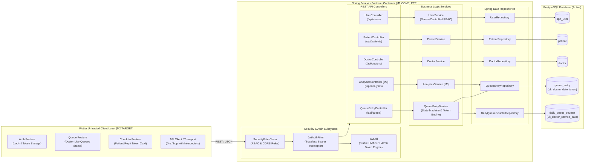
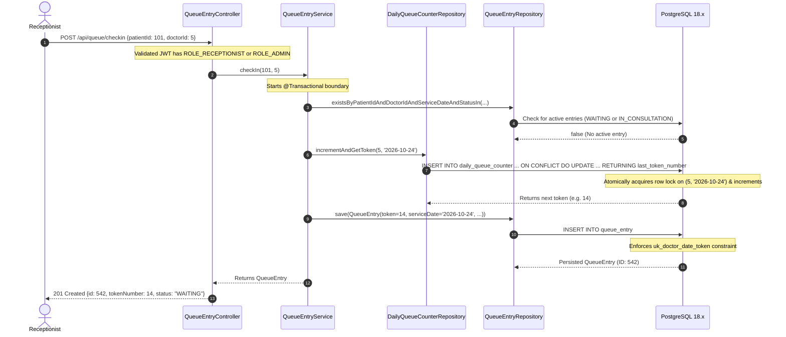
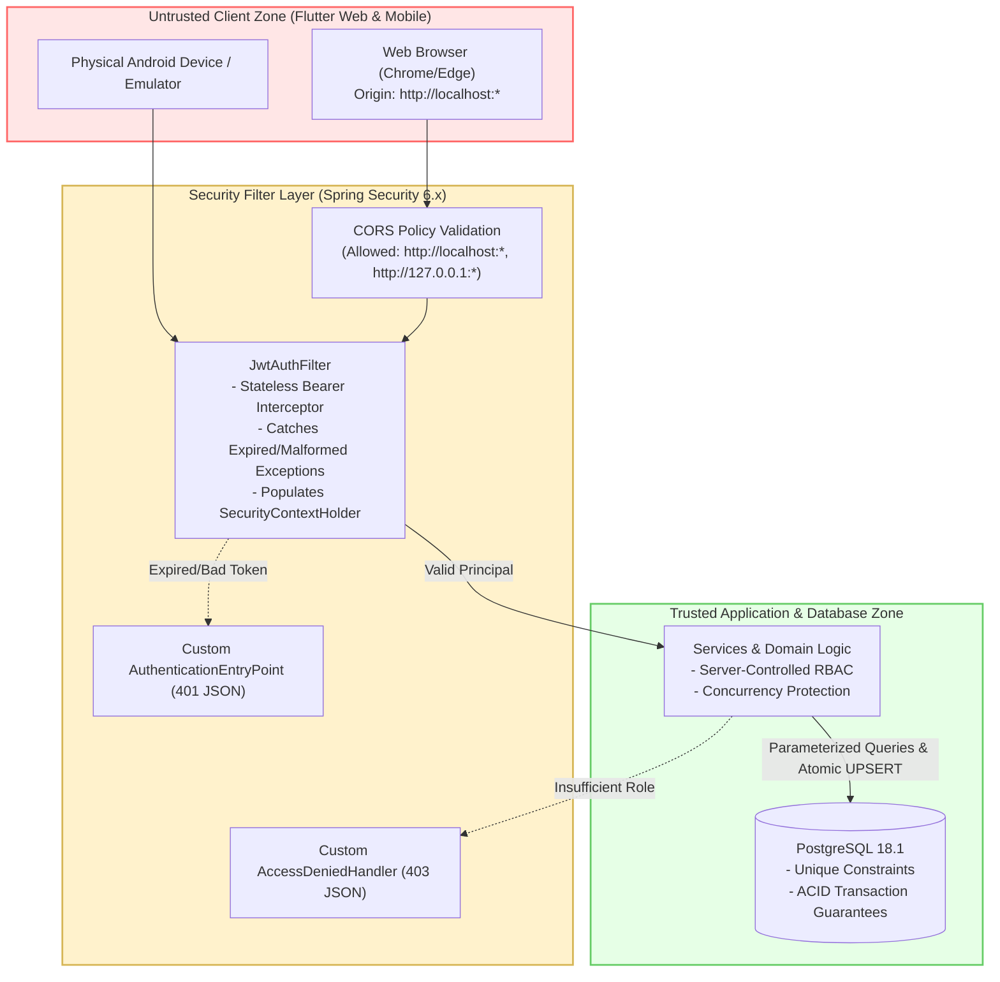

# High-Level Architecture Design (HLD)

**Project Name**: Outpatient Patient Queue Management System 2.0
**Current Milestone**: Milestone M1 (Backend Reliability & Security Complete)
**Architecture Style**: Modular Layered Monolith (Spring Boot 4.x / Java 21) + Untrusted Multi-Platform Frontend (Flutter) + PostgreSQL

---

## 1. System Context Diagram (C4 Level 1)

```mermaid
flowchart TD
    subgraph Users ["Actors & Clients"]
        Doc["Doctor\n(Android / Web)"]
        Recep["Receptionist\n(Desktop Browser)"]
        Nurse["Nurse\n(Tablet / Mobile)"]
        Mgr["Operations Manager\n(Power BI / Excel)"]
    end

    subgraph TrustBoundary ["Trusted Clinic Network Perimeter"]
        FlutterApp["Flutter Cross-Platform Client\n[UNTRUSTED UI CLIENT - M2 TARGET]\n(Dart 3.x / Flutter)"]

        subgraph BackendSystem ["Patient Queue Core Backend\n[TRUSTED SERVICE ZONE - M1 COMPLETE]"]
            SpringBootApp["Spring Boot Modular Monolith\n(Java 21 / Spring Boot 4.x / Spring Data JPA)"]
        end

        Database[("PostgreSQL 18.x\n[SYSTEM OF RECORD]\n(ACID Relational Storage)")]
    end

    Doc -->|HTTPS / REST + JWT| FlutterApp
    Recep -->|HTTPS / REST + JWT| FlutterApp
    Nurse -->|HTTPS / REST + JWT| FlutterApp

    FlutterApp -->|JSON REST APIs / Bearer Auth| SpringBootApp
    SpringBootApp -->|HikariCP / JDBC Connection Pool| Database

    Mgr -.->|Privacy-Safe CSV / Curated Views [M3]| Database
```

### Module Status Legend
- **IMPLEMENTED & VERIFIED (Milestone M1)**:
  - Stable externalized JWT key engine (`JwtUtil`).
  - Stateless Spring Security filter chain with CORS (`SecurityConfig`).
  - Concurrency-safe daily queue token allocator with PostgreSQL atomic UPSERT (`DailyQueueCounter`).
  - Duplicate check-in prevention and consultation concurrency checks (`QueueEntryService`).
  - Centralized exception mapping (`GlobalExceptionHandler` handling 400, 401, 403, 404, 409).
- **PLANNED (Milestone M2)**:
  - Untrusted responsive Flutter application in `patient-queue-flutter`.
- **PLANNED (Milestone M3)**:
  - Operational analytics endpoints and privacy-safe CSV export for Power BI / Excel.
- **DEFERRED (Milestones M4-M5)**:
  - Private clinical file/imaging uploads with metadata tracking.
  - Nurse voice note recording and draft clinical transcription.

---

## 2. Component Diagram (C4 Level 2)



---

## 3. End-to-End Sequence Workflows (Verified in M1)

### 3.1 Concurrency-Safe Check-In Sequence


---

## 4. Security & Trust Boundaries


