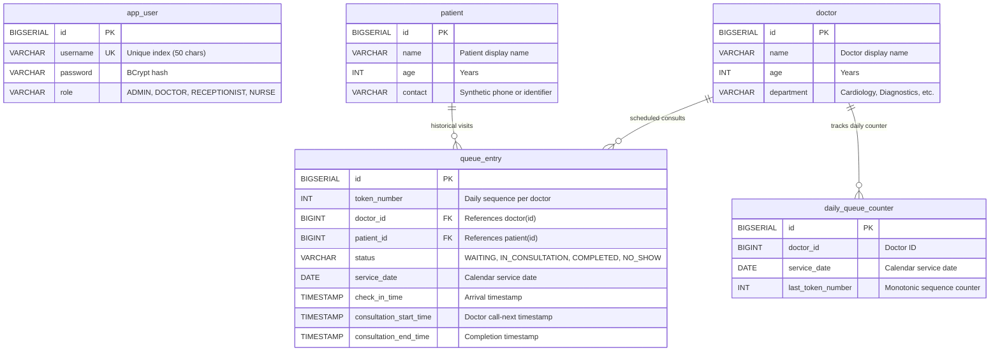
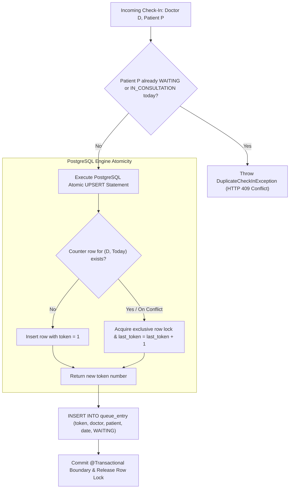

# Low-Level Architecture & Component Design (LLD)

**Project Name**: Outpatient Patient Queue Management System 2.0
**Current Milestone**: Milestone M1 (Backend Reliability & Security Complete)
**Scope**: Concrete Java Classes, Database Schemas, Concurrency Algorithms, and Flutter Client Tree

---

## 1. Concrete Database Schema & Entity Design (PostgreSQL 18.x)



### 1.1 Unique Database Constraints Implemented in M1
1. **`uk_doctor_service_date` on `daily_queue_counter`**:
   `CONSTRAINT uk_doctor_service_date UNIQUE (doctor_id, service_date)`
   Enforces a single counter row per doctor per day, enabling atomic UPSERTs.
2. **`uk_doctor_date_token` on `queue_entry`**:
   `CONSTRAINT uk_doctor_date_token UNIQUE (doctor_id, service_date, token_number)`
   Acts as a database engine-level guarantee preventing duplicate token assignments.
3. **`uk_app_user_username` on `app_user`**:
   `CONSTRAINT uk_app_user_username UNIQUE (username)`

---

## 2. Concurrency-Safe Daily Token Allocation Algorithm

### 2.1 The PostgreSQL Atomic UPSERT Mechanism
Rather than relying on application locks or vulnerable aggregate queries (`MAX(token) + 1 ... FOR UPDATE`), the system delegates token allocation to an atomic native query in `DailyQueueCounterRepository`:

```sql
INSERT INTO daily_queue_counter (doctor_id, service_date, last_token_number)
VALUES (:doctorId, :serviceDate, 1)
ON CONFLICT (doctor_id, service_date)
DO UPDATE SET last_token_number = daily_queue_counter.last_token_number + 1
RETURNING last_token_number;
```

### 2.2 Analysis of Concurrency Scenarios



1. **Initialization Race**:
   - When the clinic opens, multiple desks simultaneously checking in patients for the same doctor both execute `INSERT ... ON CONFLICT`.
   - The first transaction acquires the insert lock and assigns `token = 1`.
   - The second transaction detects the unique key conflict, pivots to `DO UPDATE`, acquires the row-level write lock, increments to `token = 2`, and returns `2`.
   - Result: Collision-free, non-blocking initialization without race conditions.
2. **Day Boundaries**:
   - `service_date` is a `LocalDate` derived from `LocalDate.now()`. When midnight crosses, a new date entry is automatically inserted starting at `token = 1`.
3. **Transaction Rollback**:
   - `checkIn` is wrapped in `@Transactional`. If patient persistence fails, the entire transaction rolls back cleanly.
4. **Duplicate Active Check-Ins**:
   - Enforced prior to counter allocation by checking `existsByPatientIdAndDoctorIdAndServiceDateAndStatusIn(..., [WAITING, IN_CONSULTATION])`.

---

## 3. Security Subsystem Design (Implemented in M1)

### 3.1 `JwtUtil` Architecture
- **HMAC Secret**: Injected via `@Value("${jwt.secret}")` with fallback. Parsed via `Keys.hmacShaKeyFor(secret.getBytes(StandardCharsets.UTF_8))` to construct a persistent 256-bit `SecretKey`.
- **Validity Window**: Configured via `@Value("${jwt.expiration-ms:36000000}")` (10 hours default).
- **Safe Verification Methods**:
  - `isTokenExpired(token)`: Safely catches `JwtException` and returns boolean.
  - `validateToken(token, expectedUsername)`: Validates username match and expiry.

### 3.2 `JwtAuthFilter` Exception Handling
Catches `JwtException` (`ExpiredJwtException`, `MalformedJwtException`, `SignatureException`, `SecurityException`) and `IllegalArgumentException`. Clears `SecurityContextHolder` and sets `request.setAttribute("jwt_error", e.getMessage())` so Spring Security's `AuthenticationEntryPoint` emits a structured 401 JSON response.

### 3.3 Server-Controlled Role Authorization (`UserService`)
To prevent **Privilege Escalation**:
- Public callers attempting to register `ADMIN` or `DOCTOR` must present an authenticated token with authority `ROLE_ADMIN`.
- Unauthenticated registration defaults strictly to `Role.RECEPTIONIST`.

---

## 4. Target Flutter Client Architecture (Milestone M2 Target)

The Flutter cross-platform client resides in `E:\Java SpringBoot\patient-queue-flutter` (as an independent sibling project).

### 4.1 Target Directory Tree
```
patient-queue-flutter/
├── lib/
│   ├── main.dart                      # App entry point, theme, route configuration
│   ├── core/
│   │   ├── constants/api_endpoints.dart # Base URLs and route constants
│   │   ├── network/api_client.dart     # HTTP client with Bearer auth interceptors
│   │   ├── network/error_handler.dart  # Maps 400, 401, 403, 404, 409 to AppExceptions
│   │   └── storage/token_storage.dart  # Secure token storage abstraction
│   ├── features/
│   │   ├── auth/                      # Login screen & token state controller
│   │   ├── queue/                     # Doctor active queue, timers, and call-next actions
│   │   ├── checkin/                   # Front-desk check-in & token confirmation badge
│   │   └── patients/                  # Patient search & registration forms
└── test/
    ├── core/network/error_handler_test.dart
    └── features/queue/queue_model_test.dart
```
