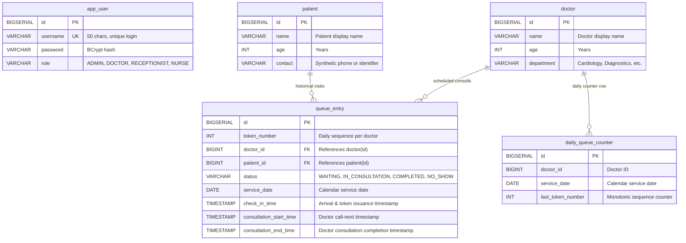

# Database Schema, SQL Analytics & KPI Specification

**Project Name**: Outpatient Patient Queue Management System 2.0
**Target RDBMS**: PostgreSQL 18.x
**Current Milestone**: Milestone M1 Complete
**Audience**: Backend Engineers, Data Analysts, Interview Preparation (Thomson Reuters Assessment Track)

---

## 1. Physical Database Schema (PostgreSQL 18.x)



### 1.1 Constraints & Indexes
```sql
-- Per-Doctor Daily Counter Uniqueness (Used for atomic UPSERT in M1)
ALTER TABLE daily_queue_counter
ADD CONSTRAINT uk_doctor_service_date UNIQUE (doctor_id, service_date);

-- Composite Unique Constraint Preventing Duplicate Token Allocation
ALTER TABLE queue_entry
ADD CONSTRAINT uk_doctor_date_token UNIQUE (doctor_id, service_date, token_number);
```

---

## 2. KPI Definitions & Cohort Rules

| KPI Metric Name | Business Definition | Mathematical Formula | Cohort Definition & Edge-Case Handling |
|---|---|---|---|
| **Total Daily Check-Ins** | Total number of patients issued a queue token on a given calendar day | `COUNT(qe.id)` | Filtered by `qe.service_date = :target_date`. Excludes nothing. |
| **Completed Consultations** | Patients whose consultation successfully concluded | `COUNT(CASE WHEN qe.status = 'COMPLETED' THEN 1 END)` | Belongs to the consultation completion cohort. Must have `consultation_end_time IS NOT NULL`. |
| **No-Show Rate (%)** | Proportion of checked-in patients who abandoned or missed their turn | `(COUNT(NO_SHOW) / Total Check-Ins) * 100.0` | **Denominator**: Check-in cohort for the day. If denominator is 0, return `0.00%` using `NULLIF`. |
| **Mean Waiting Time** | Average elapsed time from check-in to consultation start | `AVG(EXTRACT(EPOCH FROM (consultation_start_time - check_in_time)) / 60.0)` | Applies **only** to patients who reached `IN_CONSULTATION` or `COMPLETED`. Discards `NO_SHOW` and currently `WAITING`. Must assert non-negative duration (`>= 0`). |
| **Median Waiting Time (P50)** | 50th percentile wait time | `percentile_cont(0.50) WITHIN GROUP (ORDER BY wait_minutes)` | Outlier-resistant typical patient waiting duration. |
| **90th Percentile Wait (P90)** | Service level threshold where 90% of patients were seen | `percentile_cont(0.90) WITHIN GROUP (ORDER BY wait_minutes)` | Key operational SLA metric for clinic management. |
| **Wait SLA Breach Count** | Number of patients who waited longer than threshold (e.g. 30 mins) | `COUNT(CASE WHEN wait_minutes > 30 THEN 1 END)` | Tracks operational congestion. |

---

## 3. Production PostgreSQL SQL Queries (Optimized with `service_date`)

### 3.1 Daily Departmental Throughput & KPI Query

```sql
WITH visit_durations AS (
    SELECT
        qe.id AS visit_id,
        qe.service_date,
        d.id AS doctor_id,
        d.name AS doctor_name,
        d.department,
        qe.status,
        qe.check_in_time,
        qe.consultation_start_time,
        qe.consultation_end_time,
        -- Calculate wait time in fractional minutes (non-negative)
        CASE
            WHEN qe.consultation_start_time IS NOT NULL AND qe.consultation_start_time >= qe.check_in_time
            THEN EXTRACT(EPOCH FROM (qe.consultation_start_time - qe.check_in_time)) / 60.0
            ELSE NULL
        END AS wait_minutes,
        -- Calculate consultation duration in fractional minutes
        CASE
            WHEN qe.consultation_end_time IS NOT NULL AND qe.consultation_end_time >= qe.consultation_start_time
            THEN EXTRACT(EPOCH FROM (qe.consultation_end_time - qe.consultation_start_time)) / 60.0
            ELSE NULL
        END AS consult_minutes
    FROM queue_entry qe
    INNER JOIN doctor d ON qe.doctor_id = d.id
    WHERE qe.service_date = '2026-10-24'
)
SELECT
    department,
    COUNT(visit_id) AS total_check_ins,
    COUNT(CASE WHEN status = 'COMPLETED' THEN 1 END) AS completed_visits,
    COUNT(CASE WHEN status = 'NO_SHOW' THEN 1 END) AS no_shows,
    COUNT(CASE WHEN status = 'WAITING' THEN 1 END) AS currently_waiting,
    ROUND(
        (COUNT(CASE WHEN status = 'NO_SHOW' THEN 1 END)::DECIMAL / NULLIF(COUNT(visit_id), 0)) * 100.0,
        2
    ) AS no_show_rate_percent,
    ROUND(AVG(wait_minutes)::NUMERIC, 2) AS mean_wait_minutes,
    ROUND(percentile_cont(0.50) WITHIN GROUP (ORDER BY wait_minutes)::NUMERIC, 2) AS median_wait_minutes,
    ROUND(percentile_cont(0.90) WITHIN GROUP (ORDER BY wait_minutes)::NUMERIC, 2) AS p90_wait_minutes,
    COUNT(CASE WHEN wait_minutes > 30.0 THEN 1 END) AS wait_sla_breaches
FROM visit_durations
GROUP BY department
ORDER BY total_check_ins DESC;
```

---

## 4. Hand-Reconciled Synthetic Fixture for Milestone M3 Test Verification

Baseline fixture representing 10 synthetic patients for Dr. Gregory House (`Diagnostics`) on `2026-10-24`:

| Token | Status | Check-In | Start Time | End Time | Wait (min) | Consult (min) | Included in Wait Avg? |
|---|---|---|---|---|---|---|---|
| #1 | COMPLETED | 09:00:00 | 09:10:00 | 09:25:00 | 10.0 | 15.0 | Yes |
| #2 | COMPLETED | 09:05:00 | 09:25:00 | 09:40:00 | 20.0 | 15.0 | Yes |
| #3 | NO_SHOW | 09:15:00 | — | — | — | — | No |
| #4 | COMPLETED | 09:20:00 | 09:40:00 | 10:05:00 | 20.0 | 25.0 | Yes |
| #5 | COMPLETED | 09:30:00 | 10:05:00 | 10:20:00 | 35.0 | 15.0 | Yes (SLA Breach) |
| #6 | COMPLETED | 09:45:00 | 10:20:00 | 10:35:00 | 35.0 | 15.0 | Yes (SLA Breach) |
| #7 | COMPLETED | 10:00:00 | 10:35:00 | 10:45:00 | 35.0 | 10.0 | Yes (SLA Breach) |
| #8 | IN_CONSULTATION | 10:15:00 | 10:45:00 | — | 30.0 | — | Yes |
| #9 | WAITING | 10:30:00 | — | — | — | — | No |
| #10 | WAITING | 10:45:00 | — | — | — | — | No |

### Mathematical Truth:
- **Total Check-Ins**: `10`
- **Completed Visits**: `6`
- **Currently in Consultation**: `1`
- **Waiting in Lobby**: `2`
- **No-Show Count**: `1`
- **No-Show Rate**: `(1 / 10) * 100.0 = 10.00%`
- **Eligible Wait Times**: `[10.0, 20.0, 20.0, 30.0, 35.0, 35.0, 35.0]` (Total = 185.0 mins across 7 visits)
- **Mean Wait Time**: `185.0 / 7 = 26.43 minutes`
- **Median Wait Time (P50)**: `30.0 minutes`
- **90th Percentile Wait (P90)**: `35.0 minutes`
- **SLA Breaches (> 30 mins)**: `3` (Tokens #5, #6, #7)
