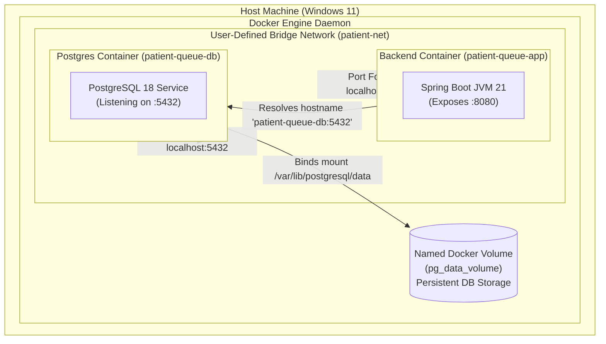

# Docker & Containerization Hands-On Learner Lab

**Target Student**: Project Owner (Hands-On Containerization Practice)
**Rule**: The software assistant will **NOT** create `Dockerfile`, `docker-compose.yml`, or launch containers. This guide provides the conceptual blueprints, commands, and exercises for the owner to implement and test personally.

---

## 1. Architectural Concepts for Dockerizing Spring Boot & PostgreSQL



---

## 2. Lab Exercises for the Learner

### Exercise 1: Multi-Stage Docker Build Theory
A multi-stage Docker build separates the heavy compilation environment (Maven + full JDK, ~800MB) from the slim production runtime (JRE or headless JDK, ~180MB).

**Concept Blueprint for your `Dockerfile`**:
1. **Stage 1 (Builder)**:
   - Base image: `eclipse-temurin:21-jdk-alpine` or `maven:3.9-eclipse-temurin-21`
   - Set working directory to `/app`
   - Copy `pom.xml` and download dependencies (`mvn dependency:go-offline`)
   - Copy `src/` and package jar (`mvn clean package -DskipTests`)
2. **Stage 2 (Runtime)**:
   - Base image: `eclipse-temurin:21-jre-alpine`
   - Create a non-root user for security (`adduser -D appuser`)
   - Copy the packaged JAR from builder stage: `COPY --from=builder /app/target/*.jar app.jar`
   - Set container entrypoint: `ENTRYPOINT ["java", "-jar", "app.jar"]`

### Exercise 2: Defining Compose Services & Networking
When using Docker Compose:
- **Service 1 (`db`)**:
  - Image: `postgres:18-alpine`
  - Environment variables: `POSTGRES_DB=patient_queue`, `POSTGRES_USER=postgres`, `POSTGRES_PASSWORD=your_secure_password`
  - Volume mount: `db_data:/var/lib/postgresql/data` (ensures patient records persist when containers restart)
  - Healthcheck: `pg_isready -U postgres`
- **Service 2 (`backend`)**:
  - Build context: `.`
  - Depends on: `db` with `condition: service_healthy`
  - Environment: `SPRING_DATASOURCE_URL=jdbc:postgresql://db:5432/patient_queue`
  - Port mapping: `"8080:8080"`

### Exercise 3: Step-by-Step Hands-On Execution Guide

Once you create your `Dockerfile` and `docker-compose.yml`, execute these commands in PowerShell:

1. **Verify Docker Desktop is running**:
   ```powershell
   docker info
   ```
2. **Build and start services in the background**:
   ```powershell
   docker compose up -d --build
   ```
3. **Inspect running containers and health status**:
   ```powershell
   docker compose ps
   ```
4. **Follow live backend application logs**:
   ```powershell
   docker compose logs -f backend
   ```
5. **Verify PostgreSQL database persistence**:
   - Check in a synthetic patient via `curl` or Postman on `http://localhost:8080/api/queue/checkin`.
   - Restart the containers:
     ```powershell
     docker compose down
     docker compose up -d
     ```
   - Fetch the doctor's queue: verify the patient is still present in PostgreSQL.

---

## 3. Database Backup & Disaster Recovery in Docker

### Backup (pg_dump) from Container to Host:
```powershell
docker exec -t patient-queue-db pg_dump -U postgres patient_queue > E:\backup_patient_queue_$(Get-Date -Format "yyyyMMdd").sql
```

### Restore SQL Dump into Container:
```powershell
Get-Content E:\backup_patient_queue.sql | docker exec -i patient-queue-db psql -U postgres -d patient_queue
```

---

## 4. Troubleshooting Checklist
- **Issue: Application fails with `Connection refused to localhost:5432`**:
  - *Cause*: Inside a Docker container, `localhost` refers to the container itself, not the host or the database container!
  - *Fix*: Set `spring.datasource.url=jdbc:postgresql://db:5432/patient_queue` where `db` is the service name defined in `docker-compose.yml`.
- **Issue: Container exits immediately with code 137**:
  - *Cause*: Out Of Memory (OOM). Ensure Docker Desktop has at least 2GB of RAM allocated in settings.
