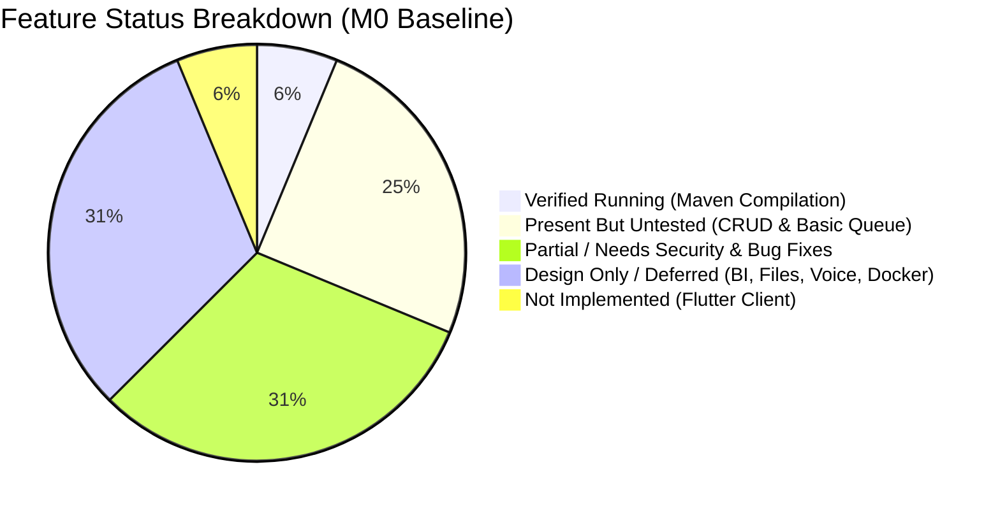

# Backlog, Technical Debt & Known Limitations

**Project Name**: Outpatient Patient Queue Management System 2.0
**Phase**: Milestone M0 Read-Only Baseline Assessment

---

## 1. Technical Debt & Defects Identified in Audit

| Defect / Limitation | Component | Severity | Recommended Fix Phase |
|---|---|---|---|
| **Ephemeral In-Memory HMAC Key** | `JwtUtil.java` | **Critical** | Milestone M1: Configure external signing secret (`application.properties` / env variable) |
| **Privilege Escalation on User Register** | `UserController.java` | **High** | Milestone M1: Sanitize role input; restrict `ADMIN` creation |
| **Token Number Concurrency Flaw** | `QueueEntryService.java` | **High** | Milestone M1: Pessimistic lock / atomic sequence counter within `@Transactional` |
| **Missing CORS Configuration** | `SecurityConfig.java` | **High** | Milestone M1: Add CORS filter allowing Flutter Web origins |
| **Unchecked JWT Parsing Exceptions** | `JwtAuthFilter.java` | **Medium** | Milestone M1: Catch `ExpiredJwtException`, `MalformedJwtException`, and return 401 |
| **Inconsistent HTTP Status Codes** | `PatientController.java` | **Low** | Milestone M1: Change `POST /api/patients` to return HTTP `201 CREATED` |
| **Entities Leaked Directly to REST API** | `QueueEntryController.java` | **Medium** | Milestone M1: Introduce dedicated `QueueEntryResponseDTO` |
| **Missing Automated Test Suite** | Maven / JUnit 5 | **High** | Milestone M1: Align Surefire plugin and write comprehensive unit tests |
| **Disk Folder Name Hyphenation** | Filesystem | **Low** | Disk directory is `patient-queue-flutter`; prompt referenced `patient_queue_flutter`. Confirm name with owner before M2 `flutter create`. |

---

## 2. Feature Implementation Status Matrix

- **Built & Compiling (Untested)**:
  - Patient CRUD (`PatientController`, `PatientService`, `PatientRepository`)
  - Doctor CRUD (`DoctorController`, `DoctorService`, `DoctorRepository`)
  - Queue basic transitions (`QueueEntryController`, `QueueEntryService`)
  - State machine enum (`QueueStatus`)
- **Planned for M1 (Backend Reliability & Security)**:
  - Persistent JWT secret & proper exception filter
  - Concurrency-safe token allocator with duplicate prevention
  - Server-side role-based access control (Admin, Doctor, Receptionist, Nurse)
  - Unit test suite for state machine, token allocation, and security
- **Planned for M2 (Flutter Frontend)**:
  - First Flutter cross-platform client in `E:\Java SpringBoot\patient-queue-flutter`
  - Mobile-first responsive screens (Login, Doctor Active Queue, Reception Check-In)
- **Planned for M3 (Operational BI & Analytics)**:
  - Daily aggregated throughput endpoints
  - Hand-reconciled synthetic test dataset
  - Privacy-safe CSV export for Excel / Power BI
- **Deferred / Stretch (M4 & M5 - Design Only)**:
  - Patient imaging / X-ray upload with path traversal protection
  - Nurse voice note recording and clinician review
  - AI clinical note transcription draft

---

## 3. Explicit Out-of-Scope Features (Documented, Not Built)

1. **Hospital Microservices Architecture**: Deliberately maintained as a modular monolith.
2. **Real-Time IoT Medical Device Streaming**: Requires physical vitals hardware; deferred indefinitely.
3. **Cross-Hospital Medical Record Exchange**: Inter-hospital FHIR/HL7 integration is out of scope for single-clinic OP queue.
4. **Paid Cloud APIs & Complex Vector Databases**: System must run locally and reproducibly without external paid dependencies.

---

## 4. Next-Step Action Plan (M0 to M1 Transition Gate)

1. **User Checkpoint**: Recommend owner create a local archive copy of `patient-queue-system` on `E:` drive to safeguard local uncommitted JWT files.
2. **Review & Sign-Off**: Present this M0 inventory, risk analysis, and architecture package for owner review.
3. **Proceed to Milestone M1 (Upon Approval)**:
   - Add unit tests for `QueueStatus` enum.
   - Externalize JWT signing secret in `application.properties`.
   - Update `JwtAuthFilter` to handle exceptions gracefully.
   - Refactor `QueueEntryService#checkIn` with concurrency protection and duplicate check.
   - Configure CORS and role matchers in `SecurityConfig`.
